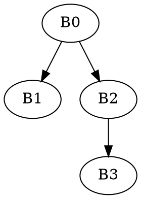

# CFG Generator

## Назначение

`cfg_generator` — модуль генерации графа потока управления (Control Flow Graph, CFG) для методов Java Card CAP-файла.

Модуль используется после завершения декомпиляции CAP-компонентов и построения модели инструкций.

CFG применяется для:

* анализа потока управления программы;
* построения базовых блоков (Basic Blocks);
* выявления переходов между инструкциями;
* анализа циклов;
* анализа обработчиков исключений;
* подготовки промежуточного представления для дальнейшего преобразования в Soot IR.


## Место в архитектуре проекта

Модуль является отдельным аналитическим уровнем и работает поверх декомпилированной модели инструкций.

Pipeline обработки:

```text
CAP file
    ↓
cap_decompile
    ↓
CAP components
    ↓
semantic model
    ↓
bytecode instructions
    ↓
cfg_generator
    ↓
Control Flow Graph (CFG)
```

Таким образом, `cfg_generator` не взаимодействует с бинарным CAP-файлом напрямую и не выполняет повторный парсинг компонентов.


## Структура модуля

```text
cfg_generator/
│
├── generator.py
│
├── model/
│   ├── basic_block.py
│   ├── edge.py
│   └── cfg.py
│
├── analysis/
│   ├── leaders.py
│   ├── block_splitter.py
│   ├── edge_builder.py
│   ├── exception_edges.py
│   └── loop_detector.py
│
├── visualization/
│   ├── dot_exporter.py
│   └── ascii_exporter.py
│
└── utils/
    └── instruction_utils.py
```


## Основные сущности

### Basic Block

Basic Block представляет линейную последовательность инструкций, выполняемую без внутренних переходов.

Базовый блок:

* имеет одну точку входа;
* имеет одну или несколько точек выхода;
* заканчивается инструкцией ветвления, перехода или возврата.

Пример:

```text
0:aload_0
1:sconst_0
2:ifeq 10
```


### Edge

Edge представляет переход между базовыми блоками.

Поддерживаются следующие типы переходов:

* `FALLTHROUGH` — последовательное выполнение;
* `CONDITIONAL_TRUE` — условный переход (ветка true);
* `CONDITIONAL_FALSE` — условный переход (ветка false);
* `GOTO` — безусловный переход;
* `RETURN` — завершение метода;
* `EXCEPTION` — переход к обработчику исключения.


### CFG

Control Flow Graph представляет ориентированный граф выполнения метода.

Граф включает:

* список базовых блоков;
* список рёбер между блоками;
* entry block;
* exit blocks.


## Этапы генерации CFG

Генерация CFG выполняется в несколько последовательных этапов.

### 1. Поиск leaders

Leader — инструкция, начинающая новый базовый блок.

Leader определяется по правилам:

1. первая инструкция метода;
2. цель перехода (`goto`, `if_*`, `tableswitch`, `lookupswitch`);
3. инструкция, следующая за условным переходом;
4. начало обработчика исключений.

Пример:

```text
0:aload_0
1:ifeq 10
4:sconst_1
5:return
10:sconst_0
11:return
```

Leaders:

```text
0
4
10
```


### 2. Разбиение на базовые блоки

После вычисления leaders инструкции метода разделяются на Basic Blocks.

Пример:

```text
B0:
0:aload_0
1:ifeq 10

B1:
4:sconst_1
5:return

B2:
10:sconst_0
11:return
```


### 3. Построение рёбер

На основе последней инструкции блока строятся переходы между блоками.

#### Условный переход

```text
ifeq 10
```

создаёт:

```text
TRUE  → target block
FALSE → next block
```

#### Безусловный переход

```text
goto 20
```

создаёт одно ребро.

#### Return

```text
return
```

не имеет successors.

#### Fallthrough

Последовательный переход между блоками.


### 4. Обработка исключений

На основе `exception_handler_info` из Method Component добавляются exception edges.

Пример:

```text
start_offset = 10
active_length = 20
handler_offset = 50
```

Для всех блоков, попадающих в диапазон:

```text
10..29
```

создаётся:

```text
EXCEPTION → handler
```


## Входные данные

Модуль принимает объект метода, полученный после декомпиляции:

```python
method.instructions
```

Каждая инструкция должна содержать:

* offset;
* opcode;
* mnemonic;
* operands.


## Пример использования

```python
from cfg_generator.generator import CFGGenerator

methods = cap_parsing.to_model()

generator = CFGGenerator()

for method in methods:
    cfg = generator.build(method)

    print(cfg)
```


## Визуализация

Модуль поддерживает визуализацию CFG в двух форматах:

* ASCII — текстовое представление для отладки;
* Graphviz — построение графа управления в виде изображения.


### Установка зависимостей

Для визуализации Graphviz необходимо установить:

1. Python-библиотеку `graphviz`
2. Системное ПО Graphviz

#### 1. Установка Python-библиотеки

```bash
pip install graphviz
```

#### 2. Установка Graphviz (системное ПО)

Необходимо скачать и установить Graphviz:

* Windows: https://graphviz.org/download/
* Linux/macOS: через пакетный менеджер

Например:

Ubuntu/Debian:

```bash
sudo apt install graphviz
```

macOS:

```bash
brew install graphviz
```


### Настройка PATH

После установки Graphviz исполняемый файл `dot` должен быть доступен из переменной окружения `PATH`.

Проверка:

```bash
dot -V
```

Ожидаемый результат:

```text
dot - graphviz version X.X.X
```

Если команда не найдена — необходимо добавить каталог `bin` Graphviz в системную переменную `PATH`.

Пример для Windows:

```text
C:\Program Files\Graphviz\bin
```

## ASCII-визуализация

ASCII-представление удобно для:

* отладки CFG;
* анализа базовых блоков;
* проверки переходов.

### Пример использования

```python
from cfg_generator.generator import CFGGenerator
from cfg_generator.visualization.ascii_exporter import ASCIIExporter

generator = CFGGenerator()
cfg = generator.build(method)

exporter = ASCIIExporter()

result = exporter.export(cfg)

print(result)
```

Пример результата:

```text
[B0]
0:aload_0
1:ifeq 20

 ├──TRUE──> B2
 └──FALSE─> B1
```

## Graphviz-визуализация

Graphviz позволяет построить полноценный граф потока управления.

### Пример использования

```python
from cfg_generator.generator import CFGGenerator
from cfg_generator.visualization.dot_exporter import DotExporter

generator = CFGGenerator()
cfg = generator.build(method)

exporter = DotExporter()

exporter.export(
    cfg,
    output_path="cfg_graph",
    format="png"
)
```

После выполнения будет создан файл:

```text
cfg_graph.png
```

### Поддерживаемые форматы

Graphviz поддерживает несколько форматов вывода:

```python
exporter.export(cfg, "cfg", format="png")
exporter.export(cfg, "cfg", format="svg")
exporter.export(cfg, "cfg", format="pdf")
```

Результат:

```text
cfg.png
cfg.svg
cfg.pdf
```

### Пример визуализации

Пример структуры графа:

```text
B0 ───────► B1
 │
 └────────► B2
               │
               ▼
              B3
```

или в DOT-представлении:



### Назначение визуализации

Graphviz-визуализация полезна для:

* анализа ветвлений;
* анализа циклов;
* проверки корректности CFG;
* подготовки преобразования CFG → Soot IR;
* отладки декомпилятора Java Card CAP.


## Расширяемость

Архитектура допускает расширение:

* анализ циклов;
* dominator tree;
* unreachable block detection;
* SSA preparation;
* преобразование CFG → Soot IR.


## Ограничения текущей версии

Текущая реализация ориентирована на Java Card CAP 2.2.x и работает только с декомпилированными инструкциями, полученными из `cap_decompile`.

Бинарный CAP-файл напрямую не анализируется.
