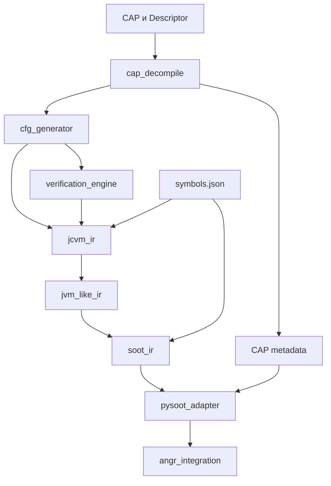
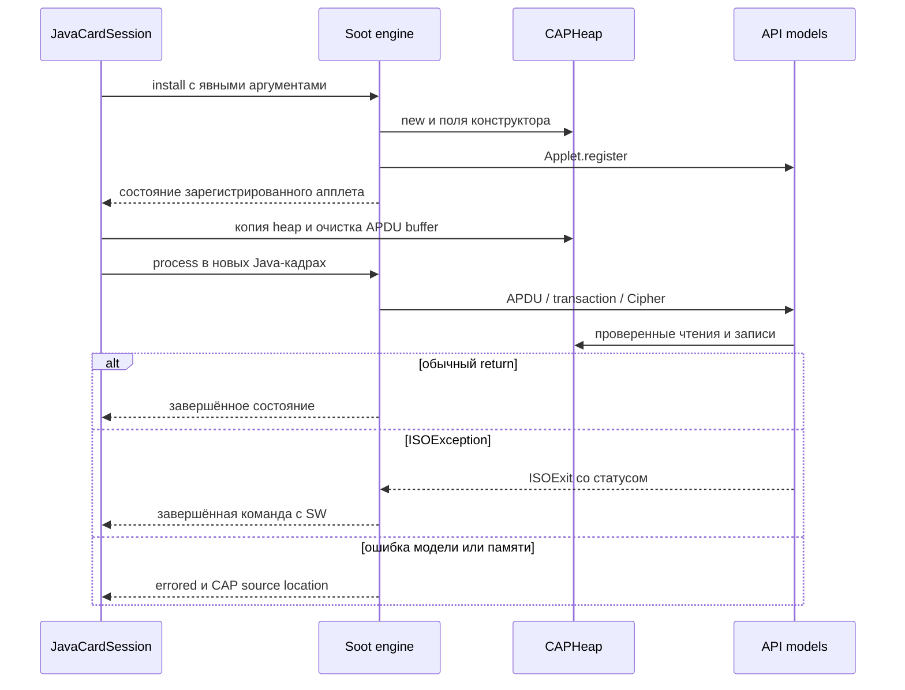

# cap2soot: полная техническая документация проекта

**Редакция: 29 октября 2026 года.** Проект: `katet3/bot1`.
Документ описывает рабочую копию после обновления исполнения Java Card
`name1-jc304-subset-v1`. Основа репозитория — commit
`071753ddf57b4182ee94eebd49147a2b84a19a7b` с накопленными изменениями.
Точные хеши 107 Python-модулей приведены в `source_snapshot.json`.

## 1. Назначение и фактический результат

cap2soot — исследовательский конвейер анализа Java Card CAP-файлов. Он извлекает
структуру и байткод, восстанавливает поток управления, последовательно уточняет
представление программы и создаёт объекты pysoot, которые загружает в angr.
Поддерживаемый поднабор исполняется через Soot engine с собственной моделью памяти
CAP и явно подключаемыми моделями Java Card API.

Исходный Java-код для анализа не обязателен: вход исполнения — CAP. В поставляемом
примере Java/JCA/EXP служат материалом для проверки соответствия декодирования
и привязок. Они не подменяют тело анализируемого метода.

Текущий воспроизводимый результат — выполнение конструктора, `install`, `process`
и приватных методов неизменённого `name1.cap`: установка ключа и IV, ECB/CBC,
ошибочные APDU и три пути для символического P1. Внешние вызовы обслуживаются
17 Python-моделями API. Присланная native C-реализация карты не компилируется
и не исполняется. Система не является полной реализацией JCRE или эмулятором
конкретного микроконтроллера.

| Возможность | Состояние |
| --- | --- |
| CAP → CFG → три уровня IR → реальные pysoot-объекты | Реализовано для поддерживаемых конструкций |
| Загрузка в angr без JVM/JAR и без запуска pysoot Lifter | Реализована |
| Числовые символические ветвления, объекты, поля, массивы, внутренние вызовы | Реализованы в проверяемом поднаборе |
| Исполнение `name1` с API-профилем | Проверено 15 APDU-сценариями |
| Символический P1 | Проверены все значения через три условия путей |
| Полностью символические DES-входы, ключ и IV | Не поддержаны; требуется единственное допустимое значение |
| Общий Java catch/throw dispatch, static fields и `<clinit>` | Исполнение не поддержано |
| Полный JCRE, firewall, GlobalPlatform, transport, tear recovery | Не реализованы |
| Taint analysis, поиск уязвимостей как готовый продукт, полный SSA/Shimple | Направления развития, не поставляемые функции |

Четыре разных утверждения нельзя смешивать: **разобран CAP**, **построено IR**,
**загружен проект angr**, **завершилось исполнение заданного состояния**.
`Unresolved symbols: 0` подтверждает привязки имён, но не наличие моделей поведения.
`Execution ready: True` подтверждает поддержку операций и достижимых методов,
но не отсутствие ошибок входных данных, памяти или исчерпания лимита шагов.

## 2. Архитектура и границы подсистем



Главный `main.py` объединяет стадии, управляет аргументами CLI и экспортом.
Бинарный формат сосредоточен в `cap_decompile`; правила семантики и исполнения
не должны попадать в парсер. Внешние зависимости pysoot/angr подключаются на
соответствующих поздних стадиях, поэтому остановка на Soot IR не требует angr.

| Подсистема | Вход | Выход | Основная обязанность |
| --- | --- | --- | --- |
| `cap_decompile` | ZIP/CAP bytes | `CAPFile`, декодированные `Instruction` | Прочитать компоненты, связать методы с Descriptor |
| `cfg_generator` | Метод с инструкциями | `CFG` | Разделить инструкции на базовые блоки и построить рёбра |
| `verification_engine` | Метод; граф строится внутри | `VerificationReport` | Выполнить зарегистрированные структурные правила |
| `jcvm_ir` | `MethodInput`, resolver, необязательный CFG | `MethodIR` | Уточнить операции, ссылки, типы и стек; проверить покрытие байткода |
| `jvm_like_ir` | Проверенный стековый `MethodIR` | `Method` с явными значениями | Устранить стек без повторения эффектов |
| `soot_ir` | Все JVM-like методы и `SymbolTable` | `Program`, `Method`, `Unit` | Создать типизированные Jimple-подобные тела и source map |
| `pysoot_adapter` | Soot `Program` и `ProgramMetadata` | `AdaptedProgram` | Построить настоящие узлы pysoot, сохранив CAP-метаданные отдельно |
| `angr_integration` | `AdaptedProgram` | `LoadedProgram`, затем состояния | Проверить поддерживаемость и исполнять через контролируемый Soot engine |

Промежуточные представления разделены намеренно. Ошибку стековой семантики можно
локализовать до генерации Soot; ошибку декларации класса — до загрузки angr;
ошибку API — до запуска либо на конкретном пути. Полное описание мотивов —
в [реестре решений](DECISIONS.md).

## 3. Идентификаторы, адреса и версии

### 3.1. Три независимых вида версий

В `name1` **CAP format = 2.2**, **версия собственного пакета = 1.0**, а framework,
security и crypto импортируются как **1.5**. Это не номера одной сущности.
Обозначение Java Card 3.0.4 относится к платформе/предоставленной реализации,
а не к байтам major/minor CAP-заголовка. Парсер содержит ветви для CAP 2.1/2.2/2.3;
наличие ветви 2.3 не доказывает полноту поддержки всех CAP 2.3.

### 3.2. Устойчивые CAP-ключи

Идентификатор строится из AID, версии пакета, класса, вида ссылки и токена/смещения.
Он не основан на позиции записи в constant pool. Переиндексация CP не должна менять
идентичность метода или поля.

| Пример | Значение |
| --- | --- |
| `112233445566@1.0:internal:t6:o56` | Внутренний метод с header-offset 56 в Method component; `install` |
| `112233445566@1.0:o2:t2:m0` | Instance field token 0 класса на смещении 2; `desKey` |
| `a0000000620101@1.5:c7:t6:m1` | Внешний static method token 1 класса 7; `ISOException.throwIt` |
| `a0000000620102@1.5:c10:t1:m5` | Interface call: Classref tag 1 плюс method token 5; `DESKey.setKey` |

`t` обозначает CAP tag, а не число параметров. `o` используется для смещения,
`c` — для внешнего class token, `m` — member token. Имена Java задаются явно в
`symbols.json`. Подмена имени не создаёт реализацию метода.

### 3.3. Пространства адресов

Следует различать header-offset метода внутри info-части Method component,
смещение инструкции от первого байта тела метода, номер Unit и адрес Soot.
Например, `getDesKey` имеет ключ с `o256`, а ошибка обращения к `null` находится
на **CAP offset 41 внутри его тела**. Это разные координаты.

Одна CAP-инструкция может породить несколько Units. Удалённые `dup`, константы
и `nop` могут иметь пустое соответствие. Пролог и мосты переходов могут не иметь
CAP-offset. `MethodIndex` переводит между CAP-ключом/offset, Unit label и
`SootAddressDescriptor(method, block_idx, stmt_idx)`. Нельзя использовать Unit
label как индекс блока. При диагностике сохраняются обе координаты.

## 4. Преобразование и инварианты

### 4.1. CAP и CFG

Контейнер выбирает `.cap`-компоненты из путей, содержащих `/javacard/`.
Текущая сборка требует Descriptor и фактически Applet component; произвольный
library CAP без Applet не является поддерживаемым входом. Компоненты хранят
декларации, CP, байткод и handler tables. Извлечение для конвейера выполняет
`jcvm_ir.methods_from_cap`, поскольку старый `CAPFile.to_model()` теряет часть
метаданных.

Декодер переводит относительные branch operands в абсолютные method-local targets.
CFG делит поток по лидерам и терминаторам. Более строгий `IRBuilder` повторно
строит нормализованный граф и сравнивает блоки и обычные рёбра с входным CFG.
Порядок и типы exception handlers восстанавливаются из таблицы обработчиков,
а не из безымянного множества CFG-рёбер.

Legacy-верификатор проверяет четыре правила, а не полную JVM/Java Card verification.
В его ошибочных ветвях есть подтверждённые дефекты формирования диагностик.
Они перечислены в [KNOWN_LIMITS.md](KNOWN_LIMITS.md); положительные тесты `name1`
не доказывают корректность этих ветвей.

### 4.2. JCVM IR

Операция содержит семантический вид, исходную mnemonic/offset, `pops`, `pushes`,
тип значения, CP reference и targets. Проверяются непрерывность инструкций,
совпадение opcode с исходным байткодом, полнота покрытия, допустимость переходов,
границы локальных слотов и совместимость стеков на слияниях.

`int` занимает два JCVM-слота; `short`, `byte`, `boolean` и reference — один.
Вычислительный stack kind для byte/boolean — `short`. Нельзя выводить типы
аргументов из одного `nargs`: одинаковое число слов может соответствовать
разным сигнатурам. Для `invokeinterface` подпись задаётся явно до построения IR.

### 4.3. JVM-like IR

Стек заменяется неизменяемыми временными значениями и параметрами блоков.
Рёбра передают аргументы этим параметрам. Локальные слоты и heap остаются
изменяемыми: представление не является полным SSA всех состояний программы.

`dup` повторно использует значение, уже полученное при load/new/call; он не
выполняет операцию второй раз. Порядок эффектов сохраняется. Сохраняются
`may_throw`, список handler indices и offsets даже для устранённых инструкций.
Валидатор проверяет definite assignment локальных слотов и не допускает
использования половины двухслотового `int` как самостоятельного значения.

### 4.4. Soot IR и pysoot

Soot IR — собственная сериализуемая модель Jimple-подобного тела. `.jimple`
предназначен для чтения; это не доказательство успешного запуска Java Soot compiler
и не готовый Shimple. Для angr используются созданные объекты pysoot, а не текст.

Числовые вычисления приводятся к Soot `int32`, а narrowing byte/short задаётся
явными cast. При переносе параметров блоков генерируются мосты: сначала все
источники копируются во временные locals, затем обновляются назначения. Это
сохраняет смысл перестановки значений на обратном ребре цикла.

Все методы сначала регистрируются, затем строятся тела — иначе внутренний вызов
метода, расположенного позже, ошибочно считался бы отсутствующим. Метаданные
классов извлекаются отдельно из Class/Descriptor: тело метода не описывает
полностью наследование, поля, access flags, токены и applet registration.

Адаптер создаёт настоящие `SootClass`, `SootMethod`, `SootBlock` и statements.
Порядок полей dataclass проверяется против фиксированной ревизии pysoot.
Дополнительная таблица `MethodDetails` хранит traps, source map и required features.
Экспорт `pysoot_output/program.json` диагностический; обратного загрузчика из
этого JSON сейчас нет.

## 5. Загрузка и исполнение angr

`CAPSootBackend` повторно использует поиск классов/методов CLE Soot, но обходит
инициализацию, запускающую `pysoot.Lifter`. Архитектура — `ArchSoot`, ОС —
`CAPSimOS`, движок — `CheckedSootEngine`. `auto_load_libs=False` и
`use_sim_procedures=False`; отсутствующие API не подменяются автоматически.

`AngrLoader.load()` индексирует все адаптированные тела и создаёт отчёт готовности.
Точка входа выбирается явно, по единственному install либо по единственному
конкретному методу. Сама загрузка не вызывает `install`, constructor или `process`.

Перед созданием call state проверяется транзитивно достижимый набор методов.
Для virtual вызова проверяются возможные объявленные конкретные receiver types;
во время исполнения выбирается фактический. Переопределения CAP ищутся по
method token и сигнатуре, поскольку синтетические имена могут различаться.
`special` сохраняет объявленную цель. Общий CAP interface dispatch требует
interface→virtual token map и пока отклоняется; для DESKey разрешена только
реализация, созданная явной моделью KeyBuilder.

Движок не пропускает ошибочную инструкцию и не создаёт unconstrained return для
неизвестного метода. `HeapError` превращается в ошибку исполнения с CAP source
location. Это политика анализа: пока общий Java exception dispatch отсутствует,
возможная ошибка памяти останавливает состояние с диагностикой.

### 5.1. Память и ограничения решателя

`state.memory` содержит Java locals и кадры вызовов angr. `state.cap_heap`
содержит объекты, поля и массивы. `HeapReference` имеет идентификатор выделения
и фактический тип. `checkcast` проверяет совместимость, но не меняет этот тип.

| Операция | Политика модели |
| --- | --- |
| Новый объект | Только по известным декларациям; instance fields получают 0/null |
| Длина нового массива | Должна иметь единственное допустимое значение |
| Максимальная длина | По умолчанию 4096; параметр loader, не вместимость реальной карты |
| Индекс primitive array | Может быть символическим, если все значения доказанно в границах |
| Индекс reference array | Должен иметь единственное допустимое значение |
| Возможный выход за границы или деление остатка на ноль | Ошибка всего текущего состояния с условием неисправности |
| Fork состояния | Словари копируются, неизменяемые значения/кортежи разделяются |
| Merge/widen | Явно не поддержаны |

Проверка `_require(condition)` спрашивает, выполнимо ли отрицание. При возможной
ошибке движок **не добавляет** удобное ограничение, которое отбросило бы опасные
входы. Но он также пока не разделяет автоматически нормальную и исключительную
ветви операции. Поэтому результат следует трактовать как ограниченное исследование
путей с явными остановками, а не как исчерпывающую верификацию произвольного CAP.

## 6. Java Card профиль и жизненный цикл

Профиль включается явно: `api_profile='name1'` либо `--javacard-profile name1`.
Имя модели — `name1-jc304-subset-v1`. Привязки проверяются по полному CAP-ключу
и owner/name/params/returns/static. Профиль добавляет только нужные декларации
Applet/APDU/Key/DESKey/Cipher и конкретные классы собственных моделей.

`JavaCardSession` рассчитан на один апплет и один логический канал. `install()`
создаёт массив install-параметров, запускает настоящий install CAP и требует
единственную ожидаемую регистрацию AID. Конструктор исполняется обычным вызовом.



Перед каждой командой создаются свежие Java-кадры; heap, API state и ограничения
переносятся из выбранного предыдущего состояния. Это предотвращает повторное
использование завершённого `Ijk_Exit` после ISOException. Один APDU object и его
260-байтовый буфер переиспользуются; буфер полностью обнуляется. Вход ограничен
255 байтами. `receive_length` позволяет смоделировать неполный первый приём.
Le, extended APDU и реальный transport не моделируются.

`run()` возвращает три независимых набора: `completed`, `errored`, `active`.
Ограничение по умолчанию — 500 шагов SimulationManager, не 500 инструкций JCVM
и не время карты. `transmit()` автоматически сохраняет следующее состояние
только при единственном завершённом пути без ошибок и активных путей.
При ветвлении клиент анализирует результаты и явно выбирает продолжение.

### 6.1. Транзакции и transient-данные

Начало транзакции сохраняет снимок instance fields и нетранзиентных массивов.
Commit удаляет снимок, abort восстанавливает значения. Вложенные транзакции,
commit без begin и allocation внутри транзакции отклоняются. Буфер APDU и данные
transient DESKey не входят в rollback. Это модель значений, а не физической NVM.

На обычной границе завершения открытая транзакция откатывается. Возврат без
закрытия транзакции даёт `uncommitted_transaction`, а не успешный `9000`.
При ISOException сохраняется её SW после rollback. Произвольные engine errors
остаются диагностическими остановками; полный JCRE recovery для них не реализован.

### 6.2. Криптография

Моделируются DES/2-key и 3-key EDE, ECB/CBC NOPAD, ключи 64/128/192 бит типа
`TYPE_DES_TRANSIENT_DESELECT`, без externalAccess/keyEncryption. Шифрование
выполняется композициями DES из PyCryptodome; так допускаются и вырожденные
комбинации ключей, которые высокоуровневый DES3 helper может отвергать.

Байты входа, ключа и IV должны быть однозначны при текущих constraints. Символическая
переменная с единственным допустимым значением разрешена; свободная — даёт
`symbolic_api_argument`. Управляющие APDU-байты могут оставаться символическими.
Данные читаются до записи результата, поэтому перекрытие буферов корректно.
Модель отслеживает версию ключа после init; неподдержанное изменение ключа
отклоняется. `deselect()` очищает transient key data; маршрутизация выбора JCRE
при этом не моделируется.

## 7. Установка и воспроизведение

Проверенная среда: Python 3.12, angr `10.0.4.post1`, CLE и archinfo `10.0.4`,
pysoot revision `16ab55db71a162efea3d44251fb93893140bbef2`, PyCryptodome `4.1.0`.
Загрузчик строго проверяет версии angr/CLE/archinfo и структуру классов pysoot.
Это проверенный набор, а не утверждение о последних доступных версиях библиотек.
Исполнение проверено на Linux; команды Windows приведены для окружения проекта,
но отдельный прогон Windows в этой работе не выполнялся.

Из корня проекта, если окружение ещё не создано:

```powershell
py -3.12 -m venv .venv-angr10
.\.venv-angr10\Scripts\python.exe -m pip install -r requirements-javacard.txt
```

Для VCS-зависимости pysoot нужен Git. В существующем окружении достаточно второй
команды. В Linux эквивалентный интерпретатор — `.venv-angr10/bin/python`.
`requirements-javacard.txt` включает requirements angr, который включает pysoot.
Без API/DES можно установить только `requirements-angr.txt`.

### 7.1. Анализ без исполнения

```powershell
.\.venv-angr10\Scripts\python.exe main.py --cap examples/name1/name1.cap --symbols examples/name1/symbols.json --output-root outputs/name1 --no-png --quiet
```

Ожидаются 7 методов, 1 pysoot-класс, ноль unresolved symbols. Без API-профиля
загрузчик корректно показывает неподдержанные внешние вызовы. Для отчёта
готовности с API добавьте `--javacard-profile name1`: это по-прежнему загрузка.

Для остановки на Soot IR добавьте `--no-pysoot`; для pysoot без angr — `--no-angr`.
`--quiet` скрывает дамп инструкций и CFG, но не ошибки и logging библиотек.
Для PNG нужны Python-пакет `graphviz==0.21` и системный `dot` в PATH.
Историческая строка `graphviz-0.21` в `requirements.txt` не является корректным
pin вида `graphviz==0.21`; текущие команды с `--no-png` обходят эту зависимость.

### 7.2. Исполнение неизменённого апплета

```powershell
.\.venv-angr10\Scripts\python.exe -m angr_integration.name1_demo
```

Ожидаемый существенный вывод:

```text
install: OK; applet AID 11223344556600
APDU scenarios passed: 15
DES ECB known-answer and ECB/CBC round-trip: OK
Symbolic P1 completed paths: 3
Expected null receiver: getDesKey, CAP offset 41
```

Последняя строка — ожидаемая ошибка исходного апплета. Поле `tempDesKey2` не
инициализируется конструктором; после выбора 16-байтового ключа обращение к нему
заканчивается `null_reference`. Это не поломка установки окружения. Harness
не подставляет SW реальной карты для необработанного NullPointerException.

Фикстура имеет package AID `112233445566`, applet AID `11223344556600`, CAP SHA-256
`edd4d74faea6ff1e37309bb0e6bf2bb35e94d97061c1f99c80f9766765941b65`.
При 24 байтах данных символический P1 полностью разбивается на P1=2 → `9000`,
P1=1 → `6700`, остальные значения → `6A86`. Проверяется не только наличие witness,
но и соответствие условий путей всем значениям этих множеств.

## 8. Выходные файлы и диагностика

| Каталог/файл | Содержимое |
| --- | --- |
| `ir_output/method_N.{json,txt}` | Стековый JCVM IR |
| `jvm_ir_output/method_N.{json,txt}` | Представление без стека |
| `soot_output/program.json`, `method_N.{json,jimple}` | Soot IR, symbols и required features |
| `pysoot_output/program.json`, `method_N.{json,txt}` | Диагностическая сериализация реальных pysoot-объектов |
| `angr_output/load_report.{json,txt}` | Готовность, версии, модели API, ограничения |
| `angr_output/addresses.json` | Обратное соответствие адресов Soot и CAP |
| `cfg_output/method_N.txt`, необязательные PNG | Представление CFG |
| `outputs/name1_execution/execution.json` | Install, 15 APDU, symbolic P1 и ожидаемая ошибка |
| `outputs/name1_execution/loader/` | Отчёт загрузки для исполняемого примера |

Первые шесть каталогов создаются под `--output-root` главного CLI. Индекс `N` —
порядок экспорта, а не стабильный идентификатор метода. Для сопоставления запусков
используйте CAP key. Экспорт не атомарный и не очищает старые результаты; для
сравнений выбирайте отдельный каталог запуска. При позднем сбое PNG часть файлов
может уже существовать.

| Симптом | Проверка и действие |
| --- | --- |
| `Missing explicit interface signature ...:c10:t1:m5` | Указать `examples/name1/symbols.json`; resolver должен получить `interface_signatures` до JCVM IR |
| `Symbol configuration ... differs from CAP` | Сверить package AID/version и порядок imports, не подменять токены именами |
| Загрузка успешна, исполнение запрещено | Читать `execution_issues` и транзитивные цели; добавить явную семантику, не выключать проверку |
| `class_hierarchy` | Отсутствует декларация предка либо есть конфликт модели с CAP |
| `symbolic_api_argument` | Параметр модели имеет несколько значений; ограничить вход по смыслу задачи либо расширить модель |
| `array_bounds`, `arithmetic_zero` | Возможен ошибочный вход; изучить condition и source location, не отбрасывать его молча |
| `active_paths > 0` | Бюджет исследования исчерпан; успех или полнота не установлены |
| Ошибка загрузки `unicornlib.dll`/`.so` | Для Soot-пути этот native backend не используется; смотреть итог и другие ошибки |
| Несовместимая версия зависимости | Установить зафиксированный набор; обновлять контракт и проверки согласованно |

## 9. Проверки и их доказательная сила

Текущий baseline — **93 теста**: 19 adapter, 18 loader, 16 heap, 14 name1/parser,
6 calls/remainder и 20 Java Card. Команда из корня проекта:

```powershell
.\.venv-angr10\Scripts\python.exe -m unittest pysoot_adapter.tests.test_adapter angr_integration.tests.test_loader angr_integration.tests.test_heap integration_tests.test_name1 angr_integration.tests.test_calls angr_integration.tests.test_javacard -v
```

Для диагностики окружения отдельно полезен `python -m pip check`.
Тесты проверяют, среди прочего, соответствие инструкций JCA, границы компонентов,
типизацию, адреса, изоляцию heap при fork, virtual dispatch по токенам, знаковый
remainder, rollback, APDU partial receive, конкретную криптографию и отказ от
произвольной concretization. Это набор регрессий, а не доказательство полной
совместимости Java Card или всех malformed CAP. Подробная карта —
в [руководстве по тестам](modules/testing_examples.md).

## 10. Порядок сопровождения и расширения

### Добавление инструкции

1. Подтвердить формат operand bytes и добавить декодирование с проверкой длины.
2. Задать JCVM pops/pushes, slots, targets и reference tags.
3. Реализовать JVM-like lowering, сохранив порядок эффектов и исключения.
4. Обновить Soot lowering/validation, source map и backend feature obligations.
5. Добавить pysoot-узел, если существующих недостаточно.
6. Реализовать и проверить runtime semantics; только после этого разрешить readiness.

Декодируемая инструкция не становится исполняемой автоматически. Например,
`instanceof` распознаётся декодером, но JCVM lowering отсутствует. Деление и shifts
имеют IR-представление, однако checked runtime не разрешает их исполнение.

### Добавление API или нового апплета

Сначала нужны CAP, согласованные symbols и точная версия экспортируемого API.
Java/JCA/EXP помогают проверить токены и сигнатуры. Для API определяются: CAP key,
контракт типов, receiver implementation, эффекты состояния, ошибки и политика
символических параметров. Модель должна копироваться независимо при fork.
Пример реальной карты полезен для сравнительной проверки APDU/SW, но одного C-файла
без окружения недостаточно для заявления об исполнении firmware.

Сначала следует проверить новый CAP без исполнения, затем install и конкретные
команды, затем символическое ветвление. Новый профиль предпочтительнее незаметного
расширения специального `Name1API`. Интерфейс профилей пока не выделен в отдельный
универсальный plugin API: добавление профиля требует изменения loader и тестов.

### Обновление зависимостей

Версия angr привязана к внутренним Soot hooks и поведению кадра вызова; обновление
не сводится к редактированию requirements. Нужно сверить pysoot dataclass contract,
адресацию, cast, return/call, обработку ошибок и отсутствие fallback для неизвестных
методов. После этого прогнать соответствующие регрессии и обновить перечень
проверенных версий. Не следует обходить version guard ради успешного импорта.

## 11. Ограничения, приоритеты и дальнейшие этапы

Ближайшая работа по устойчивости: исправление ошибочных ветвей legacy verifier,
единый handler contract между CFG и JCVM, проверка всех границ бинарного чтения,
отказ от неработающей ветви extended headers и уточнение поддержки library CAP.
Это подтверждённый технический долг, а не новые функции, выполненные в рамках
написания документации.

Следующие архитектурные этапы: ordered exception dispatch с корректным unwind,
interface token maps, class/static initialization, расширение APDU/JCRE и API,
сравнение сценариев с реальной картой. Поддержка символической криптографии
требует отдельного решения: точные bitvector-формулы, доказуемая абстракция либо
ограничение области анализа. Автоматически выбирать конкретный ключ недопустимо.

Для каждого изменения фиксируются вход, наблюдаемая семантика до/после,
поддерживаемые границы и тест, который обнаруживает прежнюю ошибку. Документация
обновляется вместе с кодом: схемы JSON, CAP keys и трактовка SW — часть контракта
для дальнейших исследований.

## 12. Навигация и источники истины

Нормативное описание **этой реализации** задают исходники и регрессионные тесты.
Общая карта документов находится в [docs/README.md](README.md), файлы и определения —
в [SOURCE_MAP.md](SOURCE_MAP.md), решения — в [DECISIONS.md](DECISIONS.md), открытые
вопросы — в [KNOWN_LIMITS.md](KNOWN_LIMITS.md).

Привязки конкретного апплета находятся в `examples/name1/symbols.json`, контрольные
хеши исходных материалов — в `examples/name1/input_manifest.json`, ограничения
профиля и использованные внешние контракты — также в `UPDATE_javacard_execution.md`.
Контракты API сопоставлялись с предоставленными native-исходниками и Oracle Java
Card 3.0.5; это не утверждение о побайтовом соответствии firmware 3.0.4. Сопровождая
проект, сначала уточняйте, документируется ли формат CAP, модель API или поведение
конкретной карты: у этих уровней разные источники и разные критерии проверки.
