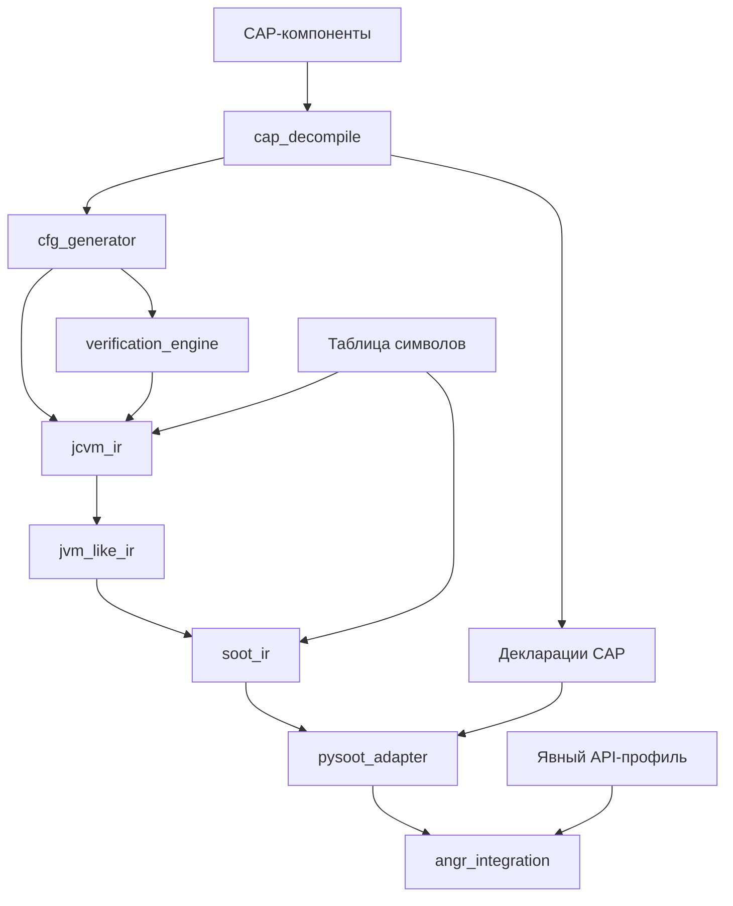
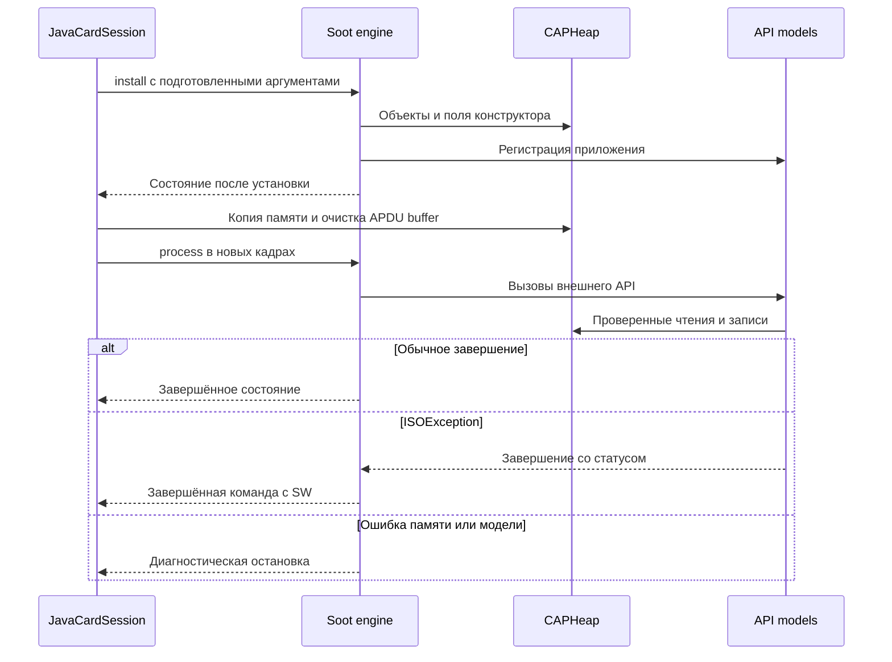

# cap2soot: техническая документация проекта

**Редакция: 30 октября 2026 года.** Репозиторий: `katet3/bot1`.
Документ описывает общую архитектуру, технологические решения, контракты подсистем
и порядок сопровождения cap2soot. Описание сверено с исходниками ревизии
`e6d944f4f335070b8603880f66c9697a2a3e49bf` с исправлениями ранних стадий D-01–D-06.

Документ не предполагает конкретных AID, классов, команд или бизнес-логики
анализируемого приложения. Материалы отдельных CAP, настройки их символов,
контрольные входы и ожидаемые результаты относятся к примерам и интеграционным
тестам. Общность архитектуры не означает поддержку произвольного CAP: фактические
границы преобразования, исполнения и моделей API указаны отдельно.

## 1. Назначение и область применения

cap2soot — исследовательский конвейер анализа Java Card CAP-файлов. Он извлекает
структуру программы и байткод, восстанавливает поток управления, последовательно
строит промежуточные представления и создаёт объекты pysoot для загрузки в angr.
Поддерживаемый поднабор программы можно исполнять с конкретными или символическими
входами, используя собственную модель памяти CAP и явно подключённые модели API.

Проект предназначен для следующих задач:

- изучение структуры CAP, инструкций, графов потока управления и вызовов;
- проверка согласованности байткода, стековой семантики и преобразований IR;
- исследование условий достижения метода или участка программы;
- получение входных значений, удовлетворяющих условиям выбранного пути;
- анализ изменений памяти и результатов последовательности вызовов;
- развитие и проверка моделей Java Card API.

Java-исходники для разбора CAP и исполнения его методов не обязательны. Они,
а также JCA/EXP и описания экспортируемых API, помогают проверить сигнатуры,
токены и соответствие исходной программе. Исполняемое тело берётся из CAP;
внешние библиотечные операции требуют отдельной модели поведения.

Проект не реализует полный JCRE, аппаратный эмулятор карты или готовый сканер
уязвимостей. Native-код прошивки не исполняется данным конвейером.

| Область | Фактическая возможность |
| --- | --- |
| CAP → CFG → JCVM IR → JVM-like IR → Soot IR | Преобразование поддерживаемых конструкций с проверками между стадиями |
| pysoot и angr | Настоящие объекты pysoot и загрузка без JVM/JAR и без pysoot Lifter |
| Исполнение | Проверяемый поднабор числовых операций, ветвлений, объектов, instance fields, массивов и внутренних вызовов |
| Java Card API | Ограниченные явные модели; доступность зависит от выбранного профиля |
| Символический анализ | Условия путей и конкретные решения в заданном начальном состоянии и бюджете исследования |
| Исключения и инициализация классов | Общий Java catch/throw dispatch, static fields и `<clinit>` не поддержаны исполнением |
| Полная платформа карты | Firewall, GlobalPlatform, физическая NVM, транспорт и восстановление после потери питания не реализованы |

Четыре результата имеют разный смысл: **CAP разобран**, **IR построено**,
**проект angr загружен**, **исследование путей выполнено**. Ни один из первых
трёх результатов сам по себе не означает исполнения приложения.

## 2. Архитектура и границы подсистем



`main.py` объединяет стадии, обрабатывает CLI и сохраняет результаты. Бинарный
формат сосредоточен в `cap_decompile`; семантика API и исполнение не входят
в обязанности парсера. Зависимости pysoot/angr подключаются на поздних стадиях:
можно получить Soot IR, не создавая проект angr.

| Подсистема | Вход | Выход | Ответственность |
| --- | --- | --- | --- |
| `cap_decompile` | CAP-контейнер | `CAPFile`, инструкции и декларации | Чтение компонентов и связывание методов с Descriptor |
| `cfg_generator` | Метод с инструкциями | `CFG` | Базовые блоки и рёбра потока управления |
| `verification_engine` | Метод; граф строится внутри | `VerificationReport` | Зарегистрированные структурные проверки |
| `jcvm_ir` | `MethodInput`, resolver, необязательный CFG | `MethodIR` | Типизированные стековые операции, ссылки, проверка покрытия байткода |
| `jvm_like_ir` | Проверенный стековый IR | `Method` с явными значениями | Устранение стека с сохранением порядка эффектов |
| `soot_ir` | JVM-like методы и `SymbolTable` | `Program`, `Method`, `Unit` | Jimple-подобные тела, типы, символы и source map |
| `pysoot_adapter` | Soot `Program` и `ProgramMetadata` | `AdaptedProgram` | Объекты pysoot и отдельные CAP-метаданные |
| `angr_integration` | `AdaptedProgram`, настройки анализа | `LoadedProgram`, состояния и результаты | Загрузка, проверка готовности, память, вызовы и контролируемое исполнение |

Разделение IR позволяет локализовать ошибку на этапе, где нарушен контракт:
стек — до Soot, декларация класса — до исполнения, неподдержанный API — при
проверке готовности либо на конкретном пути. Причины решений и условия их
пересмотра приведены в [DECISIONS.md](DECISIONS.md).

## 3. Входные данные и разрешение символов

### 3.1. CAP и сопутствующие материалы

Основной вход — CAP-контейнер с компонентами и байткодом. Текущий конвейер требует
Descriptor и фактически Applet component. Произвольный library CAP без Applet
пока не является поддерживаемым входом. Компоненты выбираются из путей контейнера,
содержащих `/javacard/`; многопакетные контейнеры требуют дополнительной поддержки.

Для воспроизводимого анализа следует хранить SHA-256 CAP, таблицу символов,
ревизию анализатора, версии зависимостей и настройки запуска. При проверке
по реальной карте дополнительно фиксируются версия её платформы и наблюдаемые
команды/ответы. Совпадение одного сценария не доказывает эквивалентность моделей.

### 3.2. Таблица символов

`symbols.json` связывает CAP-идентификаторы с именами и предоставляет сведения,
необходимые для разрешения типов и отдельных сигнатур. Конфигурация должна
соответствовать выбранному CAP; поставляемая таблица примера не универсальна.

| Поле | Назначение |
| --- | --- |
| `package_aid`, `package_version` | Идентичность собственного пакета |
| `imports` | AID и версии импортов в порядке Import component |
| `class_names` | Соответствие идентификаторов классов именам |
| `method_names` | Соответствие CAP-ключей методов именам |
| `field_names` | Соответствие CAP-ключей полей именам |
| `catch_types` | Разрешение CP-ссылок типов обработчиков исключений |
| `interface_signatures` | Явные параметры и результат интерфейсных вызовов |

Для `invokeinterface` сигнатура нужна уже при проверке стека в JCVM IR.
Число слов аргументов не позволяет однозначно восстановить их типы. Поэтому
`interface_signatures` передаются в `ReferenceResolver` до построения IR.

Разрешённое имя не является реализацией метода. `Unresolved symbols: 0` означает,
что требуемые привязки имён найдены; наличие моделей поведения проверяется отдельно.
Неизвестные имена могут сохраняться как синтетические символы для анализа,
но это не разрешает исполнение отсутствующих внешних тел.

## 4. Версии, идентификаторы и адресация

### 4.1. Независимые версии

Нужно различать версию бинарного формата CAP, версию собственного пакета,
версии импортируемых пакетов, версию платформы Java Card и версию модели API
анализатора. Эти значения описывают разные контракты и не выводятся одно из другого.

Парсер содержит ветви формата CAP 2.1/2.2/2.3. Наличие ветви или структуры данных
не означает сквозную поддержку всех возможностей версии: отдельно проверяются
декодирование, IR, адаптация и исполнение.

### 4.2. Устойчивые CAP-ключи

Ключи основаны на AID, версии, токенах и смещениях CAP, а не на позиции записи
в constant pool. Переиндексация CP не должна менять идентичность ссылки.
Ниже показаны схемы ключей; элементы в фигурных скобках — обозначения, не готовые
значения для команды запуска.

| Схема | Значение |
| --- | --- |
| `{aid}@{major}.{minor}:internal:t6:o{method_offset}` | Внутренний метод по смещению заголовка в Method component |
| `{aid}@{major}.{minor}:c{class_token}:t{tag}:m{member_token}` | Внешняя ссылка на член класса |
| `{aid}@{major}.{minor}:o{class_offset}:t{tag}:m{member_token}` | Внутренняя ссылка на член по классу и токену |

`t` обозначает CAP tag, `c` — внешний class token, `o` — смещение, `m` — member token.
Конкретный вид ключа зависит от вида ссылки. Ключи следует брать из результатов
разрешения и отчётов, а не конструировать по предполагаемым Java-именам.

### 4.3. Пространства адресов

Смещение заголовка метода в Method component, смещение инструкции внутри тела,
метка Soot Unit и адрес Soot — разные координаты. Адрес исполнения имеет вид
`SootAddressDescriptor(method, block_idx, stmt_idx)`; метка Unit не равна индексу блока.

Одна CAP-инструкция может породить несколько Units. Устранённые инструкции могут
не иметь исполняемого соответствия; служебные прологи и мосты переходов — не иметь
собственного CAP-offset. `MethodIndex` сохраняет отображения в обе стороны.

Общего автоматического соответствия «строка Java → адрес исполнения» сейчас нет.
Чтобы анализировать исходную строку, сначала нужно подтвердить её соответствие
методу и инструкциям именно исследуемого CAP. После изменения сборки прежнее
соответствие необходимо проверить заново.

## 5. Преобразования и инварианты

### 5.1. Разбор CAP, CFG и структурная проверка

Для передачи методов в конвейер используется `jcvm_ir.methods_from_cap`.
Исторический `CAPFile.to_model()` теряет часть метаданных и не подходит как
полноценная замена этому пути.

CAP linker читает обычные двухбайтовые и расширенные четырёхбайтовые заголовки.
Смещение header сохраняется до чтения относительно methods blob. Перед чтением
проверяется доступность header/body; новый список методов публикуется только после
полного успеха. Это структурный контракт: typed adapter допускает только ordinary
concrete methods и явно отклоняет extended headers до декодирования тела.

Декодер переводит относительные смещения переходов в абсолютные адреса внутри
метода. CFG выделяет лидеры, базовые блоки и рёбра. `jcvm_ir.IRBuilder` отдельно
строит нормализованный граф и сравнивает блоки и обычные рёбра с входным CFG.
Порядок и типы обработчиков берутся из таблицы handlers, а не из неупорядоченного
множества исключительных рёбер.

Обработчики передаются как `jcvm_ir.Handler` со смещениями относительно начала
байткода метода. CFG проверяет непустые диапазоны `[start, end)`, границы инструкций
и цели обработчиков; start/end/target становятся началами блоков. Конец, равный
длине тела, не создаёт пустой блок. Неверная граница или отсутствующий блок цели
даёт явную ошибку. Преобразование смещений Method component выполняет adapter,
а порядок, типы исключений и stop_bit сохраняются в исходной таблице до Soot traps.

Классификатор CFG охватывает 32 условные формы декодера, включая 16 `_w`,
goto, switch, return и throw. Инструкция после каждого terminator начинает новый
блок; после return/throw обычного перехода к нему нет. Исключительные рёбра
строятся отдельно по таблице handlers. Неподдержанные `jsr/ret` отвергаются
до создания блоков: семантика return-address не заменяется обычным продолжением.

`verification_engine` выполняет ограниченный набор структурных правил. Это не
полный Java Card verifier. Диагностики правил объединяются в плоский список.
Контекст готового CFG сохраняет все исходные рёбра для проверки, но включает
в индексы обхода только рёбра с двумя существующими концами. Несуществующие
концы диагностируются правилом без создания фиктивных блоков и изменения CFG.
Ошибки построения самого графа относятся к более ранней стадии;
ограничения перечислены в [KNOWN_LIMITS.md](KNOWN_LIMITS.md).
Успешная обработка корректного входа не подтверждает правильность всех отказов.

### 5.2. Типизированный JCVM IR

Операция хранит семантический вид, исходную mnemonic и offset, `pops`, `pushes`,
тип, ссылку и цели переходов. Проверяются покрытие исходного байткода, совпадение
opcode, допустимость targets, локальные слоты и совместимость стеков на слияниях.

`int` занимает два JCVM-слота; `short`, `byte`, `boolean` и reference — один.
Вычислительный stack kind для `byte` и `boolean` — `short`. Типы параметров
восстанавливаются из достоверной сигнатуры, а не угадываются по числу аргументов.

### 5.3. Представление без стека

JVM-like IR заменяет стек неизменяемыми временными значениями и параметрами
блоков. Рёбра передают значения этим параметрам. Локальные слоты и heap остаются
изменяемыми, поэтому это не полная SSA-форма всей программы.

`dup` повторно использует ранее вычисленное значение, не повторяя load/new/call.
Порядок побочных эффектов сохраняется. Метаданные включают `may_throw`, handlers
и исходные offsets, в том числе для устранённых инструкций. Валидатор проверяет
определённость локальных слотов и целостность двухслотового `int`.

### 5.4. Soot IR и адаптация к pysoot

Soot IR — собственная сериализуемая Jimple-подобная модель. Текст `.jimple`
предназначен для чтения; он не заменяет объекты pysoot и не подтверждает
успешный round-trip через Java-компилятор Soot или построение Shimple.

Числовые вычисления приводятся к Soot `int32`, с явным сужением к `byte`/`short`.
При переносе параметров блоков сначала сохраняются все исходные значения,
затем обновляются назначения. Это сохраняет смысл перестановок на рёбрах циклов.

Сначала регистрируются все методы, затем строятся тела: внутренний вызов не должен
зависеть от порядка методов. Наследование, поля, access flags, токены и сведения
об апплетах извлекаются из деклараций CAP отдельно от тел методов.

Адаптер создаёт реальные `SootClass`, `SootMethod`, `SootBlock` и statements.
Контракт классов сверяется с закреплённой ревизией pysoot. `MethodDetails` хранит
traps, source map и required features. Экспорт `pysoot_output/program.json`
диагностический; загрузчик не восстанавливает из него исполняемую программу.

## 6. Загрузка и контролируемое исполнение

`CAPSootBackend` использует адресацию и поиск классов/методов CLE Soot, обходя
инициализацию `pysoot.Lifter`. Архитектура — `ArchSoot`, ОС модели — `CAPSimOS`,
движок — `CheckedSootEngine`. Отключены `auto_load_libs` и `use_sim_procedures`:
неизвестные внешние вызовы не получают автоматические заглушки.

`AngrLoader.load()` принимает `AdaptedProgram`, строит индекс методов и отчёт
готовности. Точка входа задаётся CAP-ключом либо выбирается по однозначным
метаданным. Само назначение точки входа не вызывает constructor, `install`
или другой метод.

| API `LoadedProgram` | Назначение |
| --- | --- |
| `method_address(method_key)` | Адрес входа в метод |
| `address_for_label(method_key, label)` | Адрес по метке Unit |
| `addresses_for_offset(method_key, cap_offset)` | Все соответствия CAP-offset; результат может быть пустым |
| `source_location(address)` | Обратное соответствие адресу CAP и IR |
| `create_heap_state(method_key=None)` | Пустые кадры и heap для явной подготовки состояния |
| `create_call_state(method_key=None, args=(), *, receiver=None, base_state=None)` | Подготовка проверенного прямого вызова |
| `export(directory)` | Отчёт загрузки и адреса, без исследования путей |

Параметры `receiver` и `base_state` у `create_call_state` передаются по имени.
Instance-вызову нужен совместимый receiver в heap переданного `base_state`.
Ссылочные аргументы также требуют подготовленной памяти; загрузчик не создаёт
объект APDU или состояние приложения по типу параметра автоматически.

Перед созданием call state проверяется транзитивно достижимый набор методов.
`Execution ready: True` означает поддержку проверяемых операций и целей вызовов,
но не гарантирует корректность входа, отсутствие runtime fault или завершение
в заданном бюджете. Проверка консервативна и может учитывать ветви, недостижимые
при конкретных ограничениях текущей задачи.

Static/special/virtual вызовы имеют разную семантику. Virtual dispatch использует
фактический тип receiver, CAP method token и сигнатуру; special сохраняет объявленную
цель. Общая карта interface→virtual tokens пока отсутствует. Отдельные интерфейсные
вызовы допустимы через явно поддержанную реализацию модели API.

Движок не пропускает ошибочный statement и не возвращает произвольное символическое
значение за неизвестный метод. Ошибка памяти или неподдержанная операция сохраняется
как диагностическая остановка с исходной координатой, когда она доступна.

## 7. Модель состояния и памяти

`state.memory` содержит Java locals и кадры вызовов angr. `state.cap_heap`
хранит объекты, instance fields и массивы. При подключении API-профиля
`state.javacard` хранит состояние его моделей.

`HeapReference` задаёт идентификатор выделения и фактический тип. Поля учитывают
наследование. `checkcast` проверяет совместимость, сохраняя фактический тип объекта.
Нулевые ссылки и ссылки на реальные выделения различаются явно.

| Операция | Политика |
| --- | --- |
| Создание объекта | По известной декларации; instance fields получают 0/null |
| Длина нового массива | Единственное допустимое значение при текущих constraints |
| Лимит массива | По умолчанию 4096; настройка анализа, не вместимость карты |
| Индекс primitive array | Может быть символическим, если все значения доказанно в границах |
| Индекс reference array | Требует единственного допустимого значения |
| Копирование состояния при fork | Независимые изменяемые словари; совместное использование неизменяемых значений |
| Merge/widen памяти | Не поддержаны |

Для проверки безопасности операция спрашивает решатель, возможно ли нарушение
условия. Если возможно, текущее состояние останавливается. Движок не добавляет
ограничение, которое молча исключило бы ошибочные входы. Автоматического разделения
такой операции на нормальную и исключительную ветви пока нет.

Числа имеют фиксированную разрядность; расширение и сужение задаются явно.
Поддержка операции в IR не означает её разрешения в runtime. Например, знаковый
остаток реализован с проверкой возможного нулевого делителя, а общий набор делений
и сдвигов пока не входит в разрешённый поднабор исполнения.

## 8. Модели Java Card API и жизненный цикл

### 8.1. Контракт API-профиля

API-профиль задаёт внешние декларации и поведение конкретного набора библиотечных
операций. Привязка учитывает полный CAP-ключ, владельца, имя, параметры, результат
и static/instance режим. Совпадения одного Java-имени недостаточно.

Состав профилей в текущей реализации фиксирован в загрузчике. Универсального
плагинного интерфейса и автоматической генерации моделей из EXP, Java или C нет.
Доступные значения `--javacard-profile` показывает `main.py --help`; выбирать их
следует по совместимости API, а не только по имени анализируемого приложения.
Расширение набора требует изменений регистрации в loader и проверок.

Каждая модель должна явно определять предусловия, изменения состояния, результат,
ошибки и политику символических параметров. Отчёт загрузки перечисляет активные
модели и внешние декларации. Наличие профиля не означает полноту Java Card API.

### 8.2. Сессия исполнения

`JavaCardSession` — вспомогательный слой над загруженной программой с API-профилем.
Текущая реализация рассчитана на один зарегистрированный апплет и один логический
канал. Она не выполняет общую маршрутизацию JCRE между приложениями.

`install()` создаёт параметры установки, запускает CAP-метод установки и требует
единственную ожидаемую регистрацию. Конструктор исполняется обычным CAP-вызовом.
Текущий формат параметров содержит AID и пустые области control-info/application-data;
произвольные данные установки через этот helper не настраиваются.



Перед каждой командой создаются свежие Java-кадры, а heap, API state и ограничения
копируются из выбранного предыдущего состояния. Это исключает возобновление
завершённого кадра после предыдущей команды.

`prepare_command()` принимает конкретные байты 0..255 или 8-битные bitvectors
для заголовка и данных. Число входных байтов ограничено 255; длина данных и
`receive_length` задаются конкретно. Последний параметр описывает неполный первый
приём и не обязан равняться Lc. Буфер APDU имеет 260 байт и очищается перед командой.
Состояние выбора приложения задаётся извне. Le, extended APDU и транспорт отсутствуют.

`run()` возвращает `completed`, `errored`, `active`. По умолчанию бюджет — 500 шагов
SimulationManager, а не 500 JCVM-инструкций. `transmit()` сохраняет новое состояние
автоматически только при одном завершённом пути без ошибок и активных путей.
При ветвлении клиент изучает результаты и явно выбирает продолжение через `choose()`.

### 8.3. Транзакции и transient-данные

Начало транзакции сохраняет снимок instance fields и нетранзиентных массивов.
Commit удаляет снимок; abort восстанавливает значения. Вложенные транзакции,
commit без begin и выделение памяти внутри транзакции отклоняются. Буфер APDU
и данные поддержанных transient-ключей исключены из rollback.

При обработке завершённых состояний открытая транзакция откатывается. Обычный
return с незакрытой транзакцией даёт `uncommitted_transaction`, а не успешный статус.
При ISOException сохраняется её SW после отката. Произвольные engine errors
остаются остановками; полного восстановления JCRE после них нет.

Это модель значений. Физическая NVM, ресурс commit buffer, износ и потеря питания
не моделируются.

### 8.4. Криптографический поднабор

В реализованном наборе API есть DES и EDE с ключами 64/128/192 бит, ECB/CBC NOPAD
и transient-deselect ключи. Вычисления выполняются композициями DES из PyCryptodome.
Это позволяет обрабатывать и вырожденные комбинации ключей, не принимаемые
высокоуровневым DES3 helper. Другие алгоритмы не появляются автоматически.

Данные, ключ и IV должны иметь единственное допустимое значение при текущих
constraints. Свободные символические криптографические входы не поддержаны;
модель выдаёт `symbolic_api_argument`. Символическая переменная, однозначно
ограниченная условиями пути, допустима.

Чтение данных предшествует записи результата, что сохраняет смысл перекрывающихся
буферов. Модель контролирует изменение ключа после `init`. Очистка поддержанных
transient-данных при `deselect()` не заменяет полноценную модель выбора приложения.

## 9. Символьное исполнение и трактовка результата

### 9.1. Подготовка задачи

Задача анализа задаётся CAP, согласованными символами, API-профилем при необходимости,
начальным состоянием, символическими входами, целью и бюджетом исследования.
Сначала следует проверить конкретный сценарий, затем расширять область входов.

Можно начинать с прямого вызова метода либо с состояния после установки и
последовательности команд. Прямой вызов внутреннего метода показывает поведение
при переданном состоянии; достижимость этого состояния из обычного входа программы
нужно проверять отдельно.

Для примитивных аргументов `create_call_state()` поддерживает `SymbolicArgument`
и bitvectors нужной разрядности. Ссылки и содержимое heap готовятся явно.
В выбранной версии angr используется импорт `from angr import claripy`.

### 9.2. Выбор цели

Целью может быть вход в метод, известный адрес исполнения или предикат состояния.
Для поиска входа используется `loaded.method_address(key)`. Для цели внутри метода
нужно учитывать все соответствия CAP-offset и granularity шага Soot engine:
проверка только `state.addr` между шагами может не заметить statement внутри блока.
Такой поиск требует корректного разбиения шага или инструментирования исполнения.

Следующий шаблон исследует **вход в выбранный метод**. `loaded` и `initial_state`
должны быть подготовлены вызывающим кодом; `target_key` берётся из индекса CAP.

```python
def explore_method_entry(loaded, initial_state, target_key, max_steps=200):
    target = loaded.method_address(target_key)
    manager = loaded.project.factory.simgr(initial_state.copy())
    manager.explore(find=lambda state: state.addr == target, n=max_steps)
    return manager
```

Это шаблон использования Python API, не универсальная команда поиска строки Java.
Найденный вход в метод подтверждает определённый callsite лишь при дополнительной
проверке вызывающего пути: один метод может вызываться из нескольких мест.

### 9.3. Результаты исследования

| Наблюдение | Что можно заключить |
| --- | --- |
| Есть состояние в `found` | Найден хотя бы один путь до цели в заданной модели |
| Есть ограничения пути | Они описывают входы этого состояния с учётом исходных ограничений |
| Получен конкретный набор входов | Это один witness, а не полный набор решений |
| Нет найденного пути, но есть `active` | Исследование не завершено; недостижимость не установлена |
| Есть `errored` | Часть исследования остановлена ошибкой; её нельзя учитывать как обычное завершение |
| Цель найдена, другие состояния остались активными | Можно подтвердить достижение, но нельзя заявлять полный обход |

При наличии нескольких найденных путей полное условие достижения строится как
дизъюнкция их условий. Даже тогда полнота зависит от исчерпания путей в области поиска,
отсутствия диагностических остановок и границ модели. Условие одного найденного
пути не следует объявлять необходимым и достаточным без отдельной проверки.

Достижение вызова, успешный возврат из метода и успешное завершение команды —
разные цели. Проверки внутри метода могут отклонить вход, который уже достиг вызова.
Статус ошибки приложения, полученный через поддержанную ISOException, также
отличается от ошибки движка или отсутствующей модели.

Входной пакет следует получать одним совместным решением ограничений. Например,
для последовательности 8-битных выражений можно решать их `claripy.Concat` целиком.
Независимые вызовы решателя для отдельных байтов могут выбрать несовместимые модели.

Отчёт анализа должен содержать исходные ограничения, фиксированные параметры,
цель с CAP-координатами, найденные условия, witness, результаты продолжения,
ошибки и оставшиеся активные состояния. `CommandRun.summary()` требует однозначных
SW и response; для свободного символического ответа нужна отдельная форма отчёта.

## 10. Установка и общий порядок использования

### 10.1. Среда

Проверенный набор зависимостей: Python 3.12, angr `10.0.4.post1`, CLE и archinfo
`10.0.4`, pysoot revision `16ab55db71a162efea3d44251fb93893140bbef2`,
PyCryptodome `4.1.0`. Загрузчик строго проверяет версии angr/CLE/archinfo
и контракт pysoot. Это набор совместимости проекта, а не перечень последних релизов.

Из корня репозитория в PowerShell:

```powershell
py -3.12 -m venv .venv-angr10
.\.venv-angr10\Scripts\python.exe -m pip install -r requirements-javacard.txt
```

В Linux:

```bash
python3.12 -m venv .venv-angr10
.venv-angr10/bin/python -m pip install -r requirements-javacard.txt
```

Для VCS-зависимости pysoot нужен Git. `requirements-javacard.txt` включает
зависимости angr, которые включают pysoot. Для загрузки и исполнения без
криптографического API достаточно `requirements-angr.txt`. Исправность установки
зависимостей проверяется командой `python -m pip check` в выбранном окружении.

### 10.2. Анализ CAP без исполнения

В командах ниже `inputs/program.cap` и `inputs/symbols.json` — условные пути.
Их нужно заменить путями к согласованным входным файлам; такие файлы не создаются
командой и не предполагаются в поставке.

```powershell
.\.venv-angr10\Scripts\python.exe main.py --cap inputs/program.cap --symbols inputs/symbols.json --output-root outputs/run_001 --no-png --quiet
```

| Параметр | Назначение |
| --- | --- |
| `--cap` | CAP для анализа |
| `--symbols` | Согласованная таблица символов |
| `--output-root` | Каталог результатов данного запуска |
| `--no-png` | Текстовые CFG без Graphviz |
| `--quiet` | Без дампа инструкций и CFG в консоль; logging библиотек сохраняется |
| `--no-pysoot` | Завершить конвейер на Soot IR |
| `--no-angr` | Построить pysoot, не загружая angr |
| `--angr-entry` | Задать полный CAP-ключ точки входа |
| `--javacard-profile` | Подключить один из зарегистрированных API-профилей при загрузке |

`--angr-entry` и `--javacard-profile` требуют загрузки angr. Для нового входа
рекомендуется явно задавать CAP и symbols: значения CLI по умолчанию не являются
автоматическим обнаружением конфигурации исследуемого приложения.

`main.py` заканчивает работу преобразованием, загрузкой и экспортом. Даже
с API-профилем он не запускает `install`, команды или символьный поиск.
Количество классов/методов и готовность определяются входной программой.

Для PNG нужны Python-пакет `graphviz==0.21` и системная команда `dot` в PATH.
Историческая строка `graphviz-0.21` в `requirements.txt` не является корректным
закреплением этой версии. Режим `--no-png` не требует Graphviz.

### 10.3. Программное использование

Для получения `LoadedProgram` из CAP применяются те же функции, что в `main.py`:
`load_cap`, `extract_methods`, `build_cfgs`, `verify_methods`, `load_symbols`,
`build_jcvm_ir`, `build_jvm_like_ir`, `build_soot_ir`, `build_pysoot_model`,
`load_angr_program`. Сигнатуры и порядок передачи данных описаны в
[руководстве главного конвейера](modules/main.md).

После загрузки клиент выбирает метод, проверяет готовность, готовит аргументы
и память, затем создаёт SimulationManager. Для поддержанного жизненного цикла
Java Card используется `JavaCardSession`; для самостоятельного метода —
`LoadedProgram.create_call_state()`. Исследование и экспорт его результатов
выполняются вызывающим кодом отдельно от загрузчика.

## 11. Выходные файлы и диагностика

| Путь относительно `--output-root` | Содержимое |
| --- | --- |
| `ir_output/method_N.{json,txt}` | Стековый JCVM IR |
| `jvm_ir_output/method_N.{json,txt}` | Представление без стека |
| `soot_output/program.json`, `method_N.{json,jimple}` | Soot IR, символы и required features |
| `pysoot_output/program.json`, `method_N.{json,txt}` | Диагностическая сериализация pysoot |
| `angr_output/load_report.{json,txt}` | Готовность методов, зависимости, модели и ограничения |
| `angr_output/addresses.json` | Соответствие адресов Soot и CAP |
| `cfg_output/method_N.txt`, необязательные PNG | Графы управления |

Каталоги поздних стадий создаются, только если соответствующая стадия включена.
`N` — порядок экспорта, не устойчивый идентификатор. Для сравнения запусков
используются CAP-ключи. Экспорт не атомарный и не удаляет лишние файлы предыдущего
запуска; отдельный `--output-root` предотвращает смешение результатов.

| Диагностика | Проверка и действие |
| --- | --- |
| `Missing explicit interface signature` | Добавить точную сигнатуру соответствующего CAP-ключа и передать её в ранний resolver |
| `Symbol configuration ... differs from CAP` | Проверить AID, версии и порядок imports |
| `external_call` / отсутствующая модель | Уточнить контракт вызова и реализовать либо подключить совместимую модель |
| `class_hierarchy` | Проверить декларации предков и их согласованность с CAP |
| `ExecutionNotReady` | Изучить неподдержанные операции и транзитивно достижимые методы |
| `symbolic_api_argument` | Модель требует однозначного значения; обоснованно уточнить область входов или расширить модель |
| `array_bounds`, `arithmetic_zero`, `null_reference` | Исследовать условие ошибки, исходную координату и состояние памяти |
| Активные пути после остановки | Уточнить бюджет/стратегию; не объявлять поиск завершённым |
| Ошибка загрузки `unicornlib.dll`/`.so` | Для Soot-пути этот native backend не используется; проверить итог операции и остальные ошибки |
| Несовместимая версия зависимости | Восстановить закреплённый набор или согласованно обновить контракт интеграции |

Не следует подавлять ошибку ради положительного отчёта. Диагностика должна
позволять отличить неверный вход, неподдержанную возможность и дефект реализации.

## 12. Проверки и воспроизводимость

Тестирование строится по границам подсистем: разбор и связывание, семантика IR,
адаптация, адресация, память и fork, вызовы, API и сессия. Нужны как корректные
входы, так и отрицательные случаи, подтверждающие явный отказ.

Для наборов CAP linker, CFG, верификатора, adapter и angr используются команды
из корня проекта:

```powershell
.\.venv-angr10\Scripts\python.exe -m unittest discover -s cap_decompile/tests -p "test_*.py" -v
.\.venv-angr10\Scripts\python.exe -m unittest discover -s cfg_generator/tests -p "test_*.py" -v
.\.venv-angr10\Scripts\python.exe -m unittest discover -s verification_engine/tests -p "test_*.py" -v
.\.venv-angr10\Scripts\python.exe -m unittest discover -s pysoot_adapter/tests -p "test_*.py" -v
.\.venv-angr10\Scripts\python.exe -m unittest discover -s angr_integration/tests -p "test_*.py" -v
```

Интеграционные сценарии могут использовать конкретные CAP-фикстуры. Их количество,
хеши, команды и ожидаемые ответы фиксируются в соответствующих материалах,
а не задают контракт всей платформы. Карта проверок находится в
[руководстве по тестам и примерам](modules/testing_examples.md).

Число пройденных тестов не доказывает совместимость со всеми CAP или полноту
символьного исследования. Для каждого вывода нужно знать покрытую операцию,
модель окружения и границы входных данных. Сохранённый отчёт должен указывать
ревизию кода и параметры запуска; исторический лог не заменяет текущую проверку.

## 13. Сопровождение и расширение

### 13.1. Новая инструкция

1. Подтвердить формат operands, длину и правила адресации; добавить проверки чтения.
2. Задать JCVM pops/pushes, типы, slots, targets и reference tags.
3. Реализовать JVM-like lowering с сохранением эффектов и метаданных исключений.
4. Обновить Soot lowering, validation, source map и required features.
5. При необходимости расширить pysoot adapter.
6. Реализовать runtime semantics и отрицательные проверки; после этого разрешить readiness.

Наличие opcode в декодере не означает сквозную поддержку. Например, `instanceof`
декодируется, но не имеет полного JCVM lowering в текущем конвейере.

### 13.2. Новый API-профиль

Для каждой операции определяются CAP-идентичность и версия, сигнатура, объявления
классов, dispatch, эффекты памяти, ошибки и политика символических значений.
Состояние модели должно корректно копироваться при fork и не влиять на соседний путь.

Затем профиль регистрируется в загрузчике и CLI, включается в readiness и отчёт,
проверяется на нормальных и ошибочных сценариях. Пустая функция или произвольный
return не являются моделью неподдержанной операции. Если используется абстракция,
её допущения и влияние на результаты должны быть заданы явно.

### 13.3. Подключение нового CAP

Сначала сверяются CAP, версии импортов и символы. Затем проверяются преобразование,
отчёт готовности и все требуемые внешние операции. Исполнение начинается с
подготовки корректного начального состояния и конкретных входов; после этого
добавляются символические параметры и задачи достижимости.

Если найдено ограничение конвейера, оно устраняется на ответственном слое.
Специальные знания о бизнес-командах приложения должны оставаться в его сценарии
анализа, а не в парсере, общем heap или движке исполнения.

### 13.4. Обновление зависимостей и документации

Интеграция зависит от внутренних Soot hooks angr и структуры классов pysoot.
Обновление требует проверки адресов, call/return, cast, ошибок и отсутствия
неявных fallback для неизвестных методов. Замены версии в requirements недостаточно.

Изменение контракта сопровождается соответствующей документацией и регрессией.
В `PROJECT.md` обновляются общие архитектурные границы; в руководстве модуля —
его API и реализация; в примере — конкретные входы, команды и ожидаемые результаты.
Схемы JSON, устойчивые ключи и трактовка состояний являются частью интерфейса проекта.

## 14. Ограничения и направления развития

Сквозная поддержка ограничена согласованным поднабором ранних стадий, pysoot
и runtime. До расширения исполнения требуется улучшить обработку malformed CAP,
проверки бинарных границ и покрытие структурных правил. Классификация поддержанных
переходов CFG согласована с JCVM IR; это не подтверждает корректность всех форматов
декодера, включая выявленное расхождение ширины npairs у `ilookupswitch`.
Контракт handlers между CFG и JCVM согласован, в том числе на синтетическом
бинарном Method component. Для проверки полного контейнера нужны дополнительные
CAP-фикстуры с непустыми таблицами. Структурное чтение extended headers исправлено;
lowering/исполнение таких методов и library CAP требуют отдельной реализации.
Подробные подтверждённые дефекты перечислены в [KNOWN_LIMITS.md](KNOWN_LIMITS.md).

Основные незавершённые архитектурные области:

- общий dispatch исключений с упорядоченными handlers и корректным unwind;
- карты интерфейсных токенов, static fields и инициализация классов;
- более полный APDU/JCRE, несколько приложений и логических каналов;
- расширение API, включая отсутствующие сервисы безопасности;
- нормальные и исключительные ветви при возможных runtime faults;
- символическая криптография с явно выбранной точной моделью или абстракцией;
- устойчивое сопоставление исходных координат и удобный интерфейс задач анализа.

Эти пункты — направления разработки, а не доступные функции. При расширении
важно сохранять разделение между ограничением модели, ошибкой исследуемой программы
и ошибкой анализатора.

## 15. Навигация по документации

| Документ | Содержание |
| --- | --- |
| [README.md](README.md) | Общая карта документации |
| [DECISIONS.md](DECISIONS.md) | Мотивы архитектурных решений и их последствия |
| [SOURCE_MAP.md](SOURCE_MAP.md) | Каталог файлов и определений для документированного снимка |
| [source_snapshot.json](source_snapshot.json) | Хеши исходников снимка; для новой ревизии актуальность проверяется отдельно |
| [KNOWN_LIMITS.md](KNOWN_LIMITS.md) | Ограничения и подтверждённый технический долг |
| [Главный конвейер](modules/main.md) | Функции композиции и CLI |
| [CAP parser](modules/cap_decompile.md) | Компоненты, связывание и декодирование |
| [CFG](modules/cfg_generator.md) | Блоки, рёбра и визуализация |
| [Verification](modules/verification_engine.md) | Правила структурной проверки |
| [JCVM IR](modules/jcvm_ir.md) | Стековые типы и нормализация |
| [JVM-like IR](modules/jvm_like_ir.md) | Устранение стека и перенос значений |
| [Soot IR](modules/soot_ir.md) | Units, типы и source map |
| [pysoot adapter](modules/pysoot_adapter.md) | Объектная модель и метаданные |
| [angr integration](modules/angr_integration.md) | Loader, readiness, адреса, heap и вызовы |
| [Java Card runtime](modules/javacard_runtime.md) | Реализованные модели и сессия |
| [Тесты и примеры](modules/testing_examples.md) | Проверки и сценарии отдельных приложений |

Источниками истины для поведения реализации служат код и соответствующие тесты.
Стандарт формата CAP, контракт модели API и поведение физической карты относятся
к разным уровням проверки. Исторические `UPDATE_*.md` описывают отдельные этапы;
их планы не следует принимать за статус текущей реализации.
